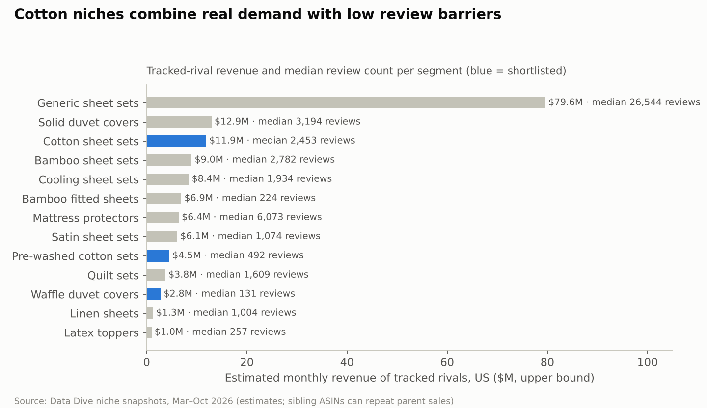
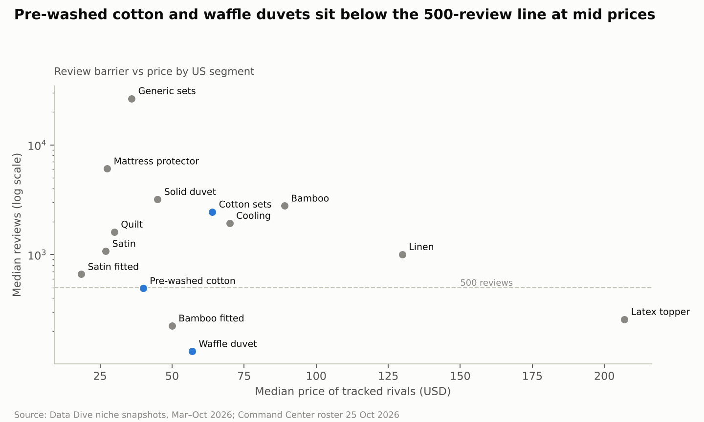
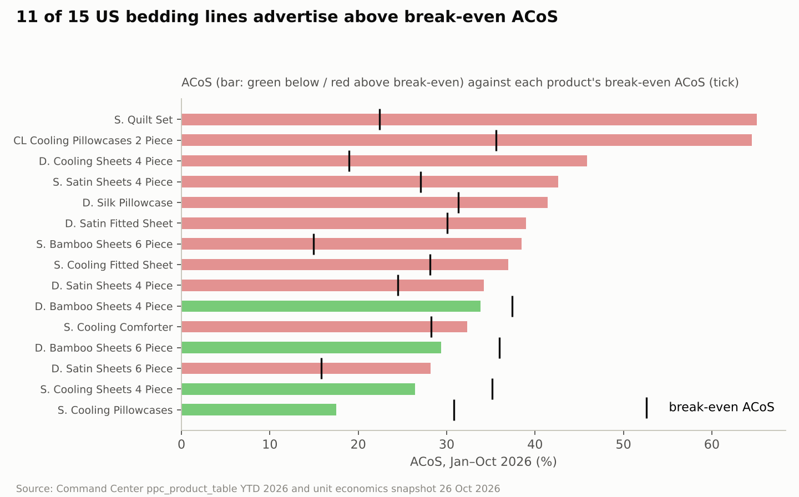
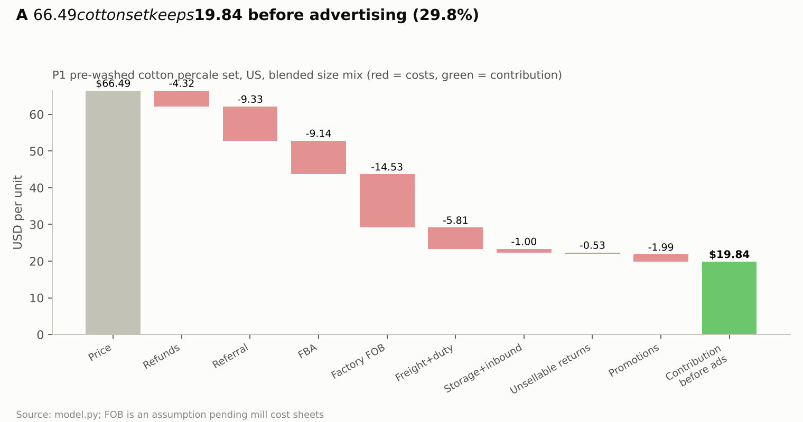
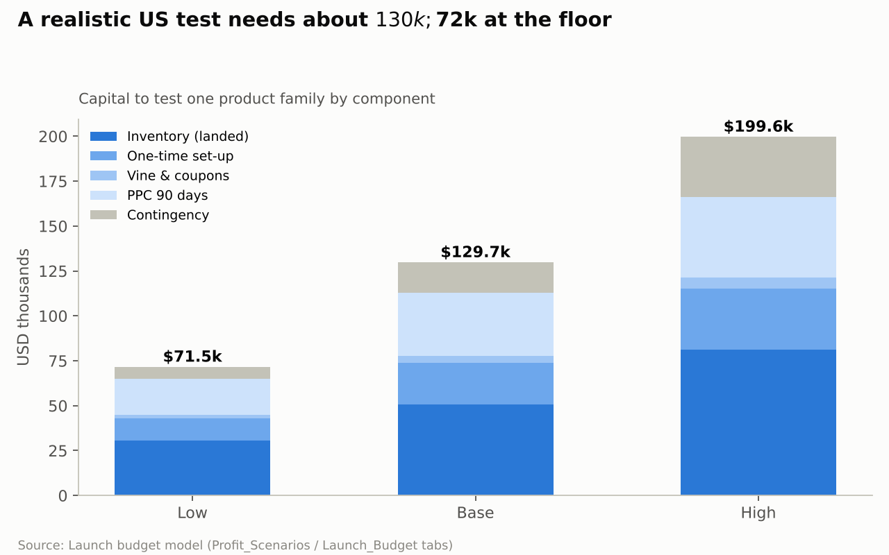
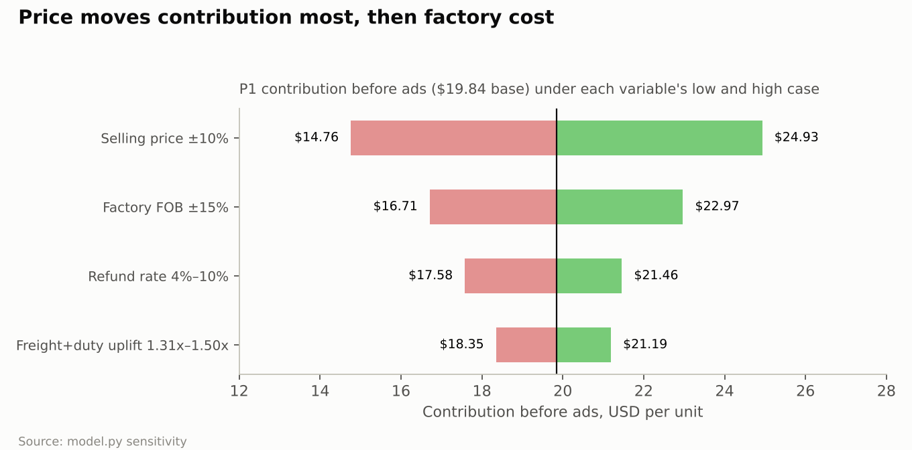
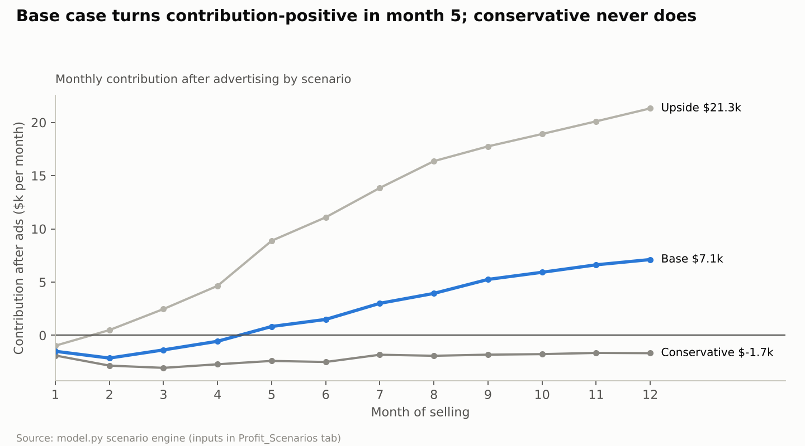
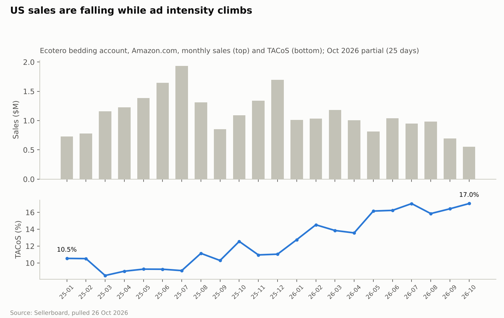

# Bedding Market Entry Feasibility — Amazon US, Canada & UK

## Executive summary

Start a cotton-only bedding brand on Amazon US with one pre-washed 100% cotton percale sheet set at $59.99–69.99, a capped test budget of about $130k, and hard stop gates at week 6 and month 4 of selling; add a cotton waffle duvet set and Canada only if the gates pass, and leave the UK for a later test.

- **What to sell:** pre-washed, pre-shrunk long-staple cotton percale (250–300 TC) 4-piece sets in Full, Queen and King, four colours, 12 SKUs. It scores 4.15 of 5 on a risk-adjusted matrix of 18 options, ahead of waffle duvet covers (3.70) and the same set in Canada (3.60).
- **Where:** the US first (about 12× Canada's search volume), Canada on the same SKUs in months 4–6, the UK only after month 9. The UK's 0% duty is outweighed by 20% VAT, low price points and a Pakistani incumbent (Utopia) at £6–20; its contribution is £8.23 per duvet set (21%).
- **Positioning:** mid-premium real cotton with a verified fit after five washes, OEKO-TEX and honest specs — above the $39.99 niche median, below $80 incumbents and $159 DTC brands.
- **Economics:** about $20.34 landed (assumed FOB $14.53 × 1.40 freight and duty), $19.84 contribution before ads (29.8% break-even ACoS), about $11.87 (18%) at a mature 12% TACoS.
- **Investment:** $72k / **$130k** / $200k to test; a further $200–350k to scale. Base case: $537k revenue, $129k ads and $29k contribution in 12 months, one-time costs recovered in month 12; the conservative case loses $26k and triggers the stop rule.
- **Why it is not a sure thing:** our established account is weakening (US sales −22.7% and net profit −48% year to date; TACoS up from 9.8% to 15.2%), our second brand pays a 5–9 point TACoS penalty, and our newest brand pays $41 per ad order. A new brand must win on a narrow niche and a provable product difference, not on our account's history.

**Evidence base:** 37 months of Sellerboard P&L (Oct 2023 – Oct 2026), Command Center PPC and economics for 18 bedding products (Jan–Oct 2026 primary window), 27 Data Dive niches, Keepa and Brand Analytics, our SLQS quilt audit, and external research on fees, duties and markets read on 26 Oct 2026. The largest open input is the mill's real cost sheet: every margin here moves $3.13 per unit for each 15% change in FOB.

## Scope, research window and data inventory

The primary window is year to date 2026 (1 Jan – 26 Oct 2026, 299 days); 2023-10 to 2025-12 is used only for seasonality and trend context. Research date for every external figure is 26 Oct 2026. October 2026 is a partial month and the last 7 days of ad data are still settling (7-day attribution).

**Evidence labels used throughout:** ACTUAL = measured in our accounts · CALC = calculated from actuals · EST = third-party estimate (Data Dive, BSR model, research reports) · ASSUMPTION = provisional input awaiting factory or forwarder quotes.

**Which account is the bedding business:** the Sellerboard account "Ecotero" (seller AY8VX9XAPH676) holds the three bedding brands — Decolure, Sleephoria and CooLinens — on Amazon.com and Amazon.ca. There is no Amazon UK seller account; UK conclusions rest on external research only.

| Data source | Marketplace | Coverage | Granularity | Metrics available | Quality | Limitations | Research use |
| --- | --- | --- | --- | --- | --- | --- | --- |
| Sellerboard P&L (Ecotero) | US, CA | Oct 2023 – 26 Oct 2026 (37 months) | Account-month, child ASIN, parent | Sales, units, orders, refunds, promos, SP/SB/SD spend, referral, FBA, storage, LTSF, COGS, gross/net profit, sessions, unit session % | Complete | COGS entered by period (unit cost; freight/duty partly missing on some SKUs); storage booked in charge month | Account history, product P&L, refund rates, YoY |
| Ecotero Command Center — PPC | US, CA | Daily from 2025; search terms from 29 Dec 2025 | Account, product, syntax group, search term, placement | Impressions, clicks, CTR, CPC, spend, orders, sales, CVR, ACoS, TACoS, match type, ad type | Complete | 7-day attribution; off-Amazon placement CVR withheld (too few orders) | Ad benchmarks, CAC, wasted spend, launch curves |
| Command Center — unit economics | US, CA | Snapshot 26 Oct 2026 (units = last 28–30 days) | SKU, size, product | Price, referral, FBA fee, landed cost (Finance tab COGS), refund rate, contribution, break-even ACoS | Mostly complete | A few SKUs carry obviously wrong COGS (flagged as outliers) | Factory-to-customer cost model |
| Command Center — aged inventory | US, CA | Age snapshot 23 Oct 2026 | Product, SKU, age bracket | Aged units, projected monthly surcharge, 6-month exposure | Complete (projection) | Projections, not bills; CA FX rate stale | Overstock lessons, working-capital risk |
| Command Center — competitors + Keepa | US (CA unmapped) | Roster scrape 25 Oct 2026; Keepa 2025-07 → today | Rival ASIN | Price, reviews, rating, BSR, sales band, coupons/deals, listing assets, monthly price/BSR history | Partial | Sales bands are estimates (\~1.4× the “bought in past month” badge); no CA roster | Competitor leaderboard, price/deal behaviour |
| Brand Analytics SQP (via Command Center) | US, CA | Weekly from 5 Jan 2025 | Query × week × our ASIN | Market search volume, impressions, clicks, cart adds, purchases, our share, median price | Sample | Covers only queries our ASINs appear on | Seasonality, demand trend, share of purchases |
| Data Dive niches | US (27 niches); 2 CA; 1 UK (knee pillow — not bedding) | Research dates Jun 2025 – Oct 2026 | Keyword, competitor ASIN | Search volume, suggested bids, rival price/reviews/est. units & revenue, ranking juice | Partial | Competitor lists pulled for 10 of 27 niches; volumes are Data Dive estimates | Demand sizing, review barrier, CPC by segment |
| Google Drive — SLQS audit (28 Aug 2026) | US | Jul–Aug 2026 | Product, SKU | Quilt-set P&L, landed cost vs unit cost, refunds by colour, deal results | Complete for its scope | Single product | New-brand failure case study |
| External research (fees, duties, market, reviews) | US, CA, UK | Read 26 Oct 2026 | Market / regulation | Fee tables, tariff rates, market sizes, complaint themes | Partial | Official sites and Amazon pages were blocked; figures come from search extracts of cited pages | Fees, landed cost, compliance, UK view |

**Not available anywhere:** factory cost sheets (FOB) for new constructions, freight and brokerage quotes, Amazon return-reason codes, review text (Amazon blocked automated access), any UK sales or advertising data, and a Canada competitor roster. These are listed as open inputs in the last section.

## Existing account, Jan–Oct 2026

The established bedding account is large but its profit is thinning: US+CA sales of $11.37M year to date earned $0.33M net profit (2.9% margin), down from $0.73M (5.4%) in the same period of 2025. One product family — Decolure bamboo sheets in the US — earns more than the whole account's profit. (ACTUAL, Sellerboard; like-for-like 1 Jan – 26 Oct in both years.)

| 1 Jan – 26 Oct | US 2025 | US 2026 | Canada 2025 | Canada 2026 |
| --- | --- | --- | --- | --- |
| Sales (USD) | $11.98M | $9.27M (−22.7%) | $1.59M | $2.11M (+33.2%) |
| Units | 250,428 | 200,282 | 35,923 | 48,079 |
| Average selling price | $47.83 | $46.26 | $44.15 | $43.92 |
| Ad spend / TACoS | $1.18M / 9.8% | $1.40M / 15.2% | $0.13M / 8.4% | $0.31M / 14.8% |
| Amazon fees % of sales | 33.5% | 38.3% | 38.6% | 38.4% |
| Storage + aged-stock fees % of sales | 3.5% | 6.5% | 6.5% | 5.8% |
| Refund rate (units) | 5.6% | 6.3% | 6.2% | 7.5% |
| Units per session (conversion) | 6.4% | 5.3% | 4.7% | 4.5% |
| Net profit / margin | $0.83M / 6.9% | $0.43M / 4.7% | −$0.10M / −6.4% | −$0.10M / −4.6% |

**What moved:** US sales fell from roughly $1.0–1.2M a month in Q1 to $0.69M in September, while ad spend stayed near $130–170k a month, so TACoS rose from 10% to 15%. Fees and storage took a further 7.8 points of sales. Canada grew 33%, but more than doubled its ad spend and still lost money. The decline is accelerating: US sales in the last 90 days are down 28% and net profit down 77% year on year, and aged-stock fees reached $261.5k year to date against $92.2k a year earlier.

**Product families, Jan–Oct 2026 (ACTUAL, Sellerboard parent rows):**

| Brand · family · marketplace | Sales | ASP | COGS / unit | Amazon fees / unit | TACoS | Net margin | Refunds |
| --- | --- | --- | --- | --- | --- | --- | --- |
| Decolure bamboo viscose sheet sets · US | $4.28M | $77.9 | $28.8 | $21.8 | 12.7% | 16.7% | 7.2% |
| Decolure satin sheet sets · US | $1.80M | $31.0 | $10.6 | $13.7 | 16.9% | 0.0% | 5.4% |
| Sleephoria/Sleep Sanctuary satin sets · US | $0.62M | $32.5 | $10.2 | $17.1 | 22.4% | −11.7% | 6.1% |
| Sleephoria cooling sheet sets · US | $0.59M | $67.2 | $27.0 | $19.2 | 7.4% | 19.5% | 6.0% |
| Sleephoria/Sleep Sanctuary bamboo sets · US | $0.47M | $66.3 | $29.6 | $22.2 | 21.9% | −5.0% | 7.0% |
| Decolure satin fitted sheet · US | $0.44M | $19.8 | $5.1 | $10.3 | 16.0% | 1.8% | 5.7% |
| Sleephoria cooling fitted sheet · US | $0.33M | $32.1 | $14.1 | $12.9 | 10.0% | 2.1% | 5.4% |
| Sleephoria quilt set · US | $0.05M | $34.2 | $11.6 | $68.8 | 48.6% | −196.6% | 13.2% |
| Decolure bamboo sheet sets · CA | $1.36M | $62.4 | $28.6 | $20.5 | 14.2% | 0.7% | 7.8% |
| Decolure satin sheet sets · CA | $0.55M | $29.8 | $10.7 | $14.2 | 19.9% | −10.1% | 8.1% |

Amazon fees per unit include storage and aged-stock surcharges. Canada figures are converted to USD by Sellerboard.

**Advertising (ACTUAL, Command Center, 1 Jan – 26 Oct 2026):** US spend $1.33M for $3.87M ad sales — ACoS 34.4%, CPC $1.79, conversion 11.1%, 82,697 ad orders, so about $16.10 of ad spend per ad order. Canada spend CAD 402k for CAD 1.54M — ACoS 26.1%, CPC CAD 1.93, conversion 11.4%. Against the previous 299 days, conversion fell about a quarter in both markets while clicks rose about 65%.

**Inventory (ACTUAL, aged-stock snapshot 23 Oct 2026):** 16,907 units are over 180 days old across 22 products, costing a projected $15.9k a month in aged-stock surcharges and about $70k over the next six months. The worst positions are the wide colour ranges: Decolure satin 4-piece (3,921 aged units, 36 SKUs) and Sleephoria satin 4-piece (2,946 aged units, 70 SKUs).

The closest internal analogue to a new brand is Sleephoria, the account's second brand selling the same constructions. It runs 5–9 points higher TACoS than Decolure on the same products and loses money in satin and bamboo, despite sharing the factory, the team and the PPC playbook.

## Market size and product taxonomy

The US is roughly three times the UK and six times Canada in bed linen, but the market a new seller can actually reach on Amazon is far smaller than the headline: it is the handful of sub-segments where the top listings do not yet hold thousands of reviews. All sizes below are third-party estimates (EST).

| Market | Bed linen market | Online share | Amazon-specific evidence |
| --- | --- | --- | --- |
| US | $8.6–10.9bn (2024–25) | 28–34% | Amazon US bedding sales \~$3.1bn in 2024, including mattresses (Furniture Today); no source splits textiles |
| Canada | \~$1.37bn (44% of a \~$3.1bn home-textile market, 2025) | \~24% | No source found; our Canadian search volume is \~8% of US for the same queries |
| UK | \~$3.5bn (Mordor-implied; range $1.8–5.4bn by definition) | UK bedding e-commerce \~$1.26bn (2024) | Amazon is among the top 5 UK bedroom-textile retailers with Dunelm, ASDA, Tesco and B&M (low-quality source) |

Three layers matter: the broad market above; the Amazon-addressable market, sized below from tracked competitor sets; and the realistic new-entrant slice, which depends on the review barrier and ad cost in each segment.

**US segment taxonomy (Data Dive estimates at each niche's research date, Mar–Oct 2026 unless noted; CPC = median suggested bid of the top 50 keywords):**

| Segment | Head-term monthly searches | Median price | Median reviews of tracked rivals | Rivals under 500 reviews | Est. monthly revenue of tracked set | Suggested CPC | Seasonality | Fit for a Pakistan mill |
| --- | --- | --- | --- | --- | --- | --- | --- | --- |
| Generic sheet & pillowcase sets (mostly microfiber) | "queen sheets" 205–291k | $35.98 | 26,544 | 0% | $79.6M (30 rivals) | $2.64 | Q4 + January | Low: price war led by CGK, Utopia, Bedsure |
| 100% / organic cotton sheet sets | "cotton sheets" 97k | $63.99 | 2,453 | 15% | $11.9M (20) | $2.63 | Stable | High: core Pakistani construction |
| Pre-washed cotton sheet sets | niche head 25k | $39.99 | 492 | 73% | $4.5M (11, upper bound) | $2.21 | Stable | High |
| Viscose-from-bamboo sheet sets | "bamboo sheets" 205–342k | $88.99 | 2,782 | 14% | $9.0M (21) | $6.43 | Jun–Aug, Nov | Medium: viscose fabric often Chinese-woven (origin risk) |
| Cooling sheet sets | "cooling sheets" 112k | $69.99 | 1,934 | 10% | $8.4M (30) | $1.41 | May–Aug at \~3× January | Medium |
| Polyester satin sheet sets | "silk sheets" 133k, "satin sheets" 78k | $25.49–26.99 | 1,074–5,500 | 0–27% | $3.5–6.1M | $1.25–1.97 | Flat, November bump | Medium: low price, polyester |
| Fitted sheets (satin / bamboo) | 108k / 695k niche total | $18.49 / $49.99 | 662 / 224 | 35% / 60% | $0.47M / $6.9M | $1.11 / n.a. | Follows parent | High |
| Linen sheets (Jun 2025 data) | "linen sheets" 58k | $129.89 | 1,004 | 30% | $1.3M (10) | $2.61 | Summer | Low–medium: flax imported |
| Solid duvet covers | "duvet cover" 504k | $44.99 | 3,194 | 19% | $13.0M (26) | $1.29 | Autumn–winter | High (cotton) |
| Waffle-weave duvet covers | "queen duvet cover" 132k | $56.99 | 131 | 85% | $2.8M (13); top 3 = 90% | $1.44 | Autumn–winter | High: needs dobby/waffle looms |
| Quilt sets | "quilt" 182k | $29.99 | 1,609 | 20% | $3.8M (25) | $0.56 | Spring–summer | Medium: bulky, 0.7 cu ft box |
| Comforters | — | $54 | 757 | — | — | — | Q4 | Medium: bulky |
| Waterproof mattress protectors (Aug 2025) | "twin xl mattress protector" 122k | $27.49 | 6,073 | 5% | $6.4M (20) | $1.86 | Back-to-school | Medium: needs TPU-laminated fabric |
| Latex mattress toppers | "latex mattress topper" 25k | $207 | 257 | 60% | $1.0M (5) | $1.33 | — | Low: not a textile line; oversize FBA fees |
| Silk / satin pillowcases | "silk pillowcase" 120k | $22 (all pillowcases) | 3,135 | — | — | $3.05 | Nov–Dec | Low for mulberry silk; medium for satin |

Revenue totals are upper bounds: Data Dive repeats parent-level sales on sibling ASINs. The UK and Canada have no equivalent niche data; their segment views are in the marketplace section.

## Marketplace analysis: US, Canada, UK

Launch the US first, follow with Canada on the same SKUs within 4–6 months, and treat the UK as a later, selective test with UK-size products. The US has the demand and our operating know-how; Canada is cheap to add because sizes and labels largely carry over; the UK's 0% duty is outweighed by 20% VAT, low price points and a Pakistani incumbent (Utopia) that already dominates at £6–20.

|  | Amazon US | Amazon Canada | Amazon UK |
| --- | --- | --- | --- |
| Bed linen market (EST) | $8.6–10.9bn; 28–34% online | \~$1.37bn; \~24% online | \~$3.5bn (range $1.8–5.4bn) |
| Addressable demand signal | "cotton sheets" 97k + "100% cotton sheets" 71k monthly searches; tracked cotton set revenue \~$11.9M/month (EST) | \~8% of US search volume for the same queries (SQP, ACTUAL); CA bamboo niche \~6.4k units/month across 20 rivals | No internal data; UK fitted-sheet and duvet-set best sellers carry 100k+ ratings |
| Leading segments | Generic microfiber sets, bamboo, cotton, duvet covers, satin, quilts | Bamboo and satin (our brands lead), generic sets | Fitted sheets, duvet cover sets, pillowcases, mattress protectors; 4-piece US-style sets are weaker |
| Price tiers | Low $13–30 microfiber/satin · mid $40–70 cotton/cooling · high $80–150 bamboo/linen | Low CAD 25–45 · mid CAD 60–95 · high CAD 100+ (bamboo median \~CAD 92) | Low £6–20 microfibre · mid £11–34 cotton · high £40+ (Egyptian cotton, linen) |
| Main competitors | Bedsure, Pure Bamboo, CGK, California Design Den, LANE LINEN, MooMee, Love's Cabin, BEDELITE, Utopia | Decolure (ours) #1–2 in bamboo and satin; Amazon Basics, CGK, Softan, hotel-style unbranded | Utopia Bedding, Bedsure, Amazon Basics, GC Gaveno, Catherine Lansfield, Dreamscene, Sleepdown |
| Promotion behaviour | Leaders use strike-through list prices, few coupons; Prime Day (23–26 Jun 2026), October event, BFCM | Same events; our CA ads run at lower ACoS (26%) | Duvet demand rises autumn–winter; deep low-price competition |
| CPC (ACTUAL / EST) | Account $1.79; cotton terms $2.21–2.64 suggested | Account CAD 1.93; CA suggested bids CAD 0.50–0.77 | No internal data; third-party UK benchmarks not found |
| Review barrier | Cotton sets median 2,453; pre-washed niche 492 | Bamboo 522, satin 1,406 | Leaders 100k+; cotton tier lower but unmeasured |
| Duty on cotton set | 16.7% (incl. 10% Section 301) | 17% | 0% (DCTS) + 20% import VAT, recoverable |
| P1-type contribution before ads | $19.84 (29.8%) | CAD 25.96 (28.4%) | £8.23 (21.1%) on a duvet set |
| Launch capital (test, one family) | $72k low · $130k base · $200k high | +$35–60k incremental using US stock and listings | $60–90k (new SKUs in UK sizes, VAT, EORI, UK responsible person) |
| Main risks | 10% tariff and importer-of-record rules; high CPC; review barrier | Small market; CARM security; bilingual labels; long transit | VAT and UK-size SKUs; price war with a Pakistani incumbent; no internal data |
| Difficulty for a new brand | High overall; medium in pre-washed cotton and waffle duvets | Medium–low | High |
| **Recommendation** | **Launch first** | **Launch later (months 4–6), same SKUs** | **Test selectively later (months 9–12), only after US validation** |

**Why not Canada first?** Canada's lower review barrier and our team's strong share there make it the easiest place to win a Best Seller badge, but at \~8% of US demand it cannot prove whether the brand scales. It is better used as a cheap second market once US listings, images and reviews exist (the creative, A+ content and listing work carry over; how much US review history shows on Amazon.ca should be checked on our own listings before relying on it).

**Why not the UK first?** The UK needs different SKUs (Double, King, Super King; duvet-led), a separate VAT and compliance set-up, and has no internal data. Its contribution per unit is the lowest of the three markets even with 0% duty.

## Product opportunity matrix

Pre-washed 100% cotton percale sheet sets score highest on a risk-adjusted basis (4.15 of 5), followed by cotton waffle duvet covers (3.70) and Canada as a second market for the same sheet set (3.60). Bamboo scores well on demand and margin but poorly on competition and risk; microfiber, toppers and satin score lowest.

**Method.** Each opportunity is scored 1–5 on six criteria (5 = best for us), weighted: demand 20% (searches, tracked revenue), profitability 20% (break-even ACoS), competition 20% (review barrier and concentration, 5 = easiest), differentiation 15% (fixable complaints, room to stand apart), operational feasibility 15% (mill fit, duty, packaging cube) and risk 10% (regulatory, cannibalisation, internal track record; 5 = lowest risk). Scores are judgements built from the evidence cited in each row; change a score and the total moves accordingly in the workbook.

| Opportunity | Demand | Profit | Competition | Differentiation | Operations | Risk | Score | Key evidence |
| --- | --- | --- | --- | --- | --- | --- | --- | --- |
| Pre-washed cotton percale set · US | 4 | 4 | 4 | 4 | 5 | 4 | **4.15** | 492 median reviews, 73% of rivals < 500; $39.99 median; 29.8% break-even ACoS; core Pakistani construction; 16.7% duty |
| Cotton waffle duvet cover set · US | 4 | 3 | 4 | 4 | 4 | 3 | **3.70** | "duvet cover" 504k searches; median 131 reviews but Bedsure holds 90%; 28.1% break-even |
| Cotton percale set · Canada | 2 | 4 | 4 | 4 | 4 | 4 | **3.60** | \~8% of US demand; review barrier 522; 28.4% break-even; our team leads CA |
| Cotton sateen set · US | 2 | 4 | 3 | 3 | 5 | 4 | 3.40 | "sateen sheets" only 6k searches; wrinkle complaints |
| Cotton fitted sheet (standalone) · US | 3 | 2 | 4 | 3 | 5 | 4 | 3.40 | Lowest review barrier (fitted median 501) but $17–39 prices |
| Solid cotton duvet cover · US | 5 | 3 | 2 | 2 | 5 | 3 | 3.35 | Large demand; median 3,194 reviews; Bedsure $6.5M/month |
| Viscose-from-bamboo set · US | 5 | 5 | 2 | 2 | 3 | 2 | 3.35 | 37% break-even on our account, but CPC $6.43, 2,782 median reviews, Chinese-fabric origin risk, cannibalises Decolure |
| Cooling sheet set · US | 4 | 4 | 2 | 3 | 3 | 3 | 3.20 | Seasonal 3× swing; 3,324 median reviews; new CooLinens brand pays $41/order |
| Organic (GOTS) cotton set · US | 3 | 4 | 2 | 4 | 3 | 3 | 3.15 | $63.99 median; 2,453 reviews; certification cost |
| Quilt set · US | 4 | 2 | 3 | 3 | 3 | 2 | 2.90 | Our SLQS lost $20k/month; FBA $11.81; 16% refunds on light colours |
| Linen set · US | 2 | 4 | 3 | 3 | 2 | 3 | 2.85 | 58k searches; flax not grown in Pakistan |
| Polyester satin set · US | 4 | 2 | 2 | 2 | 4 | 3 | 2.80 | $26 median; 4,704 reviews; our satin earns \~0% net |
| Cotton percale duvet set · UK | 3 | 2 | 2 | 3 | 4 | 3 | 2.75 | 0% duty but £8.23 contribution (21%) after VAT |
| Silk pillowcase · US | 4 | 4 | 2 | 2 | 1 | 3 | 2.75 | Mulberry silk is not a Pakistani core fibre |
| Waterproof mattress protector · US | 4 | 3 | 1 | 2 | 3 | 3 | 2.65 | 6,073 median reviews; Utopia 123k reviews |
| Comforter · US | 3 | 3 | 3 | 2 | 2 | 2 | 2.60 | Bulky FBA and storage; REST dominates premium |
| Microfiber generic set · US/UK | 5 | 1 | 1 | 1 | 3 | 2 | 2.20 | CGK 443k reviews at $25–35; Utopia £6–11 in the UK |
| Latex mattress topper · US | 1 | 3 | 3 | 2 | 1 | 2 | 2.05 | Not a textile line; oversize fees; flammability rules |

**The top opportunity against the 13 questions (P1, pre-washed cotton percale set, US):**

1. **What are customers buying?** Breathable 100% cotton 4-piece sets at $40–70, mostly Queen and King.
2. **Why?** Cooler, crisper sleep than microfiber; "real cotton" without the price of DTC brands ($159+ at Brooklinen).
3. **Dominant specs:** 200–400 TC percale, long-staple or combed cotton, 15–16" pockets, garment-washed or stonewashed finish.
4. **Common complaints:** shrinkage that leaves pockets too shallow, pilling, wrinkles, scratchy first feel.
5. **Price points with demand:** $40–60 (LANE LINEN, MooMee, CDD) and $60–85 (MooMee, organic tier).
6. **What justifies a premium:** measured post-wash pocket depth, long-staple yarn, OEKO-TEX, pre-washed softness, honest thread count.
7. **What is commoditised:** "luxury hotel", thread-count claims, colour count.
8. **Can a Pakistan mill make it competitively?** Yes: cotton percale is Pakistan's core bed-linen export ($3.1bn bed-wear exports FY24-25), and in-house weaving secures origin.
9. **QC and testing:** dimensional stability after 3 and 5 washes (AATCC 135), pilling (ASTM D3512), colour-fastness to washing and light, seam strength, OEKO-TEX Standard 100.
10. **Landed cost and contribution:** $20.34 landed, $19.84 contribution before ads (29.8%).
11. **Launch advertising:** $20–45 per order early; $35k base for 90 days.
12. **Entry difficulty:** medium in the pre-washed sub-niche, high on generic "cotton sheets".
13. **What would make it meaningfully different:** a published shrink-tested fit (for example "fits 16" after 5 washes"), corner labels, a mill-direct quality story, and fewer, better colours.

## Competitor leaderboard and how the leaders win

Each US segment is held by two or three brands with tens of thousands of reviews and 300–450 new reviews a month; the top 10 brands hold 79–98% of estimated units in every segment we track. Leaders win on review mass, wide size-and-colour grids and strike-through list prices, not on coupons. Rival units and revenue are estimates from sales-rank brackets (as of 25 Oct 2026), which run about 1.4× higher than Amazon's "bought in past month" badge.

**US leaderboard by segment (EST unless marked):**

| Segment | Leader · price · reviews · est. units/month | #2 | #3 | Top-3 share of tracked units | Our share of tracked units |
| --- | --- | --- | --- | --- | --- |
| Viscose-from-bamboo sets | Bedsure · $56 · 65.2k · \~37k | Pure Bamboo · $100 · 23.6k · \~35k | Love's Cabin · $36 · 2.0k · \~20k | 52% | 1.1% |
| Polyester satin sets | BEDELITE · $36 · 6.8k · \~34k | Love's Cabin · $20 · 5.8k · \~14k | MR&HM · $32 · 17.9k · \~10k | 52% | 3.3% |
| Cooling sheet sets | Bedsure · \~37k | Pure Bamboo · \~35k | Bella Coterie · $135 · 5.9k · \~11k | 63% | 0.8% |
| Quilt sets | Love's Cabin · $27 · 9.5k · \~26k | WDCOZY · $45 · 6.0k · \~17k | Exclusivo Mezcla · $25 · 17.4k · \~5.6k | 59% | 0.03% |
| Comforters | REST · $172 · 4.1k · \~8.4k | Cozy Bliss · $60 · 2.7k · \~5k | HOMFINE · $44 · \~2.6k | 69% | — |
| Pillowcases | ZIMASILK · $37 · 52k · \~26k | INFIIXSO · $65 · 10.6k · \~26k | WISHSMILE · $20 · \~7k | 63% | — |
| Fitted sheets | BEDELITE · $18 · 1.9k · \~9.8k | Zaizaihome · $29 · 1.1k · \~4k | Homiest · $14 · \~3k | 63% | — |
| Cotton sheet sets (Data Dive revenue) | LANE LINEN · $35–85 · 30.8k · $5.2M/mo | California Design Den · $28–90 · 87.1k · $4.2M/mo | MooMee · $80 · 1.7k · $0.7M/mo | 54% | none |
| Pre-washed cotton sets (Data Dive) | LANE LINEN · $40–75 · 33.6k · $2.3M/mo | MooMee · $35–80 · 1.0k · $1.9M/mo | K MASANIJI · $60 · 495 · $0.16M/mo | 85% | none |
| Solid duvet covers (Data Dive) | Bedsure · $18–175 · 38.5k · $6.5M/mo | MooMee · $90 · 14.9k · $2.1M/mo | CGK Unlimited · $38 · 8.5k · $1.1M/mo | 46% | none |
| Waffle duvet covers (Data Dive) | Bedsure · $84–90 · 4.2k · $2.2M/mo | PHF · $38–40 · 1.0k · $0.37M/mo | David's Home · $47–55 · 193 | 90% | none |
| Waterproof mattress protectors (Data Dive) | Utopia Bedding · $25–29 · 123k · $2.8M/mo | Nordic Elk · $30 · 18.1k | Four Seasons Essentials · $39–42 · 13.1k | 56% | none |
| Generic sheet sets (Data Dive) | CGK Unlimited · $25–35 · 443k · $19.4M/mo | California Design Den · $37–70 · 88k · $11.3M/mo | LANE LINEN · $45–90 · 32.9k · $11.2M/mo | 36% | none |

**Review barrier, top-20 core rivals (median / p75 reviews):** satin 4,704 / 6,994 · cooling 3,324 / 8,488 · pillowcases 3,135 / 7,255 · bamboo 1,961 / 5,940 · quilts 1,529 / 4,420 · comforters 757 / 1,493 · fitted sheets 501 / 680. Prices (p25 / median / p75): bamboo $60 / $80 / $100 · cooling $65 / $85 / $119 · quilts $28 / $39 / $45 · satin $20 / $26 / $29 · fitted $17 / $22 / $39.

**How the leaders win (Keepa, Jan–Oct 2026, observed):**

- **Review velocity, not coupons.** Pure Bamboo added \~448 reviews a month and Bedsure \~341; satin leaders MR&HM and BEDELITE added 184–195. Leaders ran coupons on almost no days this year.
- **Strike-through list prices.** Pure Bamboo sells at $105 against a $140 list price, Bedsure at $59 against $75, Lanest at $29 against $41.
- **Deep size-and-colour grids** that collect every size and colour search under one parent, plus A+ content and 7–9 images on all leaders.
- **Two price models coexist.** Volume brands (Bedsure, Love's Cabin, CGK) sit at $20–60; premium brands (Pure Bamboo, Bella Coterie, REST) sell at $100–350 on a single strong claim — genuine bamboo or cooling technology — with fewer reviews.

**Who is behind them (research, not verified at source):** Utopia Bedding is a Karachi mill brand that self-reports $169.5M exports in FY24 and leads Amazon UK; California Design Den and Mayfair Linen are made in India; Bedsure belongs to Shinebed (Wuxi, China). A Pakistani mill-owned brand winning on Amazon is therefore proven, but only at very large scale and low price.

**Vulnerabilities a new entrant could use:** pre-washed cotton and waffle duvet covers have leaders with fewer than 500 reviews below the top two; fitted sheets have the lowest review barrier; quilt and satin leaders draw complaints about thinness, colour and slipping that a mill can fix; and no tracked leader states a measured pocket depth after washing.

**Canada:** our own brands lead. Decolure ranks #1–2 in Canadian bamboo (\~1.2–1.3k units/month each) and #1 in satin (\~1.2k); Canadian rivals' median reviews are 522 in bamboo and 1,406 in satin (Data Dive, Jan–Feb 2026).

**UK (Best Seller snapshots, undated):** Utopia Bedding is #1 in fitted sheets (from £6.37, 135k ratings), sheet sets, duvet sets and pillowcases; Bedsure, Amazon Basics, GC Gaveno, Sonia Moonlight and Pamposh fill the microfibre tier; Catherine Lansfield, Dreamscene and Sleepdown lead printed duvet sets at £8–25; cotton sits at £11–34 (Yard, Amazon Basics 400TC).

## Entry difficulty and the three entry scenarios

A commodity entry would fail on our own evidence; the realistic path is a differentiated product placed inside a focused niche — Scenario B delivered through Scenario C. No ranking timeline is promised: our bamboo fitted-sheet launch held 45–67 orders a week only while spend stayed near $500 a week.

**Difficulty indicators for the shortlisted US segments (EST unless marked):**

| Indicator | Pre-washed cotton sets | Generic "cotton sheets" | Waffle duvet covers | Bamboo (reference) |
| --- | --- | --- | --- | --- |
| Head-term monthly searches | \~25k niche head; long tail via size/colour terms | 97k + 71k | 132k ("queen duvet cover") | 205–342k |
| Median / p75 reviews of tracked rivals | 492 / 724 | 2,453 / 9,596 | 131 / 276 | 2,782 / 5,938 |
| Rivals under 500 reviews | 73% | 15% | 85% | 14% |
| Top-3 revenue share | 85% | 54% | 90% | 76% |
| Median price | $39.99 | $63.99 | $56.99 | $88.99 |
| Suggested CPC | $2.21 | $2.63 | $1.44 | $6.43 |
| Our internal proof | none | none | none | 37% break-even, 16.7% net margin on Decolure |

High top-3 shares in the two easiest niches mean one or two brands (LANE LINEN, MooMee; Bedsure) take most sales, but the long tail below them is thinly reviewed — the place a new brand can rank first.

|  | A — Commodity entry | B — Differentiated entry | C — Focused niche entry |
| --- | --- | --- | --- |
| Example | Microfiber or polyester satin sets at $20–35 | Cotton percale set with tested fit, pre-washed finish, OEKO-TEX, honest specs | Pre-washed cotton percale sets and cotton waffle duvet covers |
| What makes entry hard | Leaders with 18k–443k reviews; satin median price $26; CPC above break-even | Proving the difference in images and reviews; head terms cost $2.6+ per click | Small head terms; one or two dominant brands; limited keyword pool |
| Structural barriers | Price floor set by Chinese microfiber ($3.90–7.50 FOB) and Utopia's scale; our satin earns \~0% net | Review mass of incumbents; 16.7% US duty | Niche ceiling; seasonality of duvets |
| Temporary barriers | None that money removes cheaply | Zero reviews at launch; no brand recognition (Amazon drops unrecognised brand names from titles, as it did for Sleephoria) | Zero reviews; listing quality |
| What we must do | — (do not pursue) | Lab-test fit and shrinkage; show results on the listing; Vine; 4–6 colours only | Win the long-tail and size terms first, then widen to generic cotton terms |
| Early sign of success (weeks 4–12) | — | Conversion ≥ 8% on 1,500+ clicks; refund rate ≤ 7%; rating ≥ 4.3 | Organic share ≥ 25% by week 12; top-10 rank on 3+ niche terms |
| Evidence to scale | — | Ad spend per order ≤ $25 and contribution after ads > 0 by month 4 | Organic share ≥ 35% and TACoS ≤ 22% by month 6 |
| Evidence to stop | Already met on internal data | Conversion < 6% after 3,000 clicks, or refunds > 10% | No organic traction (< 15% organic) by month 5 at full budget |

**Barriers that are structural for any newcomer:** review counts in the thousands, the 10% US tariff on Pakistan (while it stands) and Amazon's inbound limits for new accounts. **Barriers that time removes:** zero reviews, unrecognised brand name and an empty search-term history — each costs money for 3–6 months, which the ad budget is sized for.

## Advertising requirements and customer acquisition cost

A new brand should plan on $25–45 of ad spend per order in the first 90 days, versus $16 for our mature US account, and a 90-day US validation budget of about $30–45k for one product family. Internal figures are ACTUAL for 1 Jan – 26 Oct 2026 (Command Center, 7-day attribution); new-brand figures are CALC from the closest internal launches.

**Internal benchmarks, US unless marked (ACTUAL, YTD 2026):**

| Product (maturity) | Spend | ACoS | CPC | Click-to-order CVR | Ad spend per order |
| --- | --- | --- | --- | --- | --- |
| Account average, US | $1.33M | 34.4% | $1.79 | 11.1% | $16.11 |
| Account average, Canada (CAD) | 402k | 26.1% | 1.93 | 11.4% | 16.95 |
| Decolure bamboo 4-pc (mature, $89) | $282k | 33.8% | $3.10 | 11.9% | $26.13 |
| Decolure bamboo 6-pc (mature, $96) | $251k | 29.4% | $3.39 | 14.1% | $23.97 |
| Decolure satin 4-pc (mature, $32) | $184k | 34.2% | $1.36 | 12.9% | $10.61 |
| Sleephoria satin 4-pc (second brand) | $139k | 42.6% | $2.05 | 14.5% | $14.18 |
| Sleephoria bamboo 6-pc (second brand) | $103k | 38.5% | $3.43 | 12.7% | $26.95 |
| Sleephoria cooling sheets ($79) | $40k | 26.4% | $2.09 | 11.9% | $17.61 |
| Sleephoria quilt set (new brand-line, $42) | $23k | 65.1% | $0.72 | 3.0% | $24.41 |
| Decolure bamboo fitted (launched Jul 2026) | $3.8k | 27.8% | $2.11 | 20.9% | $10.09 |
| CooLinens cooling sheets (new brand, Oct 2026, $88) | $4.7k | 47.4% | $3.38 | 8.2% | $41.32 |
| Canada, Decolure bamboo 6-pc (CAD) | 142k | 23.4% | 2.49 | 12.0% | 20.77 |

**By match type (US, drillable products):** Exact $533k at $2.72 CPC, 42.4% ACoS, $20.02 per order; Broad $109k at $1.55 CPC, 23.9% ACoS, $12.09 per order; Phrase $17k at $0.94 CPC, 39.3% ACoS. **By objective (US):** Ranking campaigns ran at 43.2% ACoS on 33% of spend; defensive brand campaigns at 14.0%. The SLQS audit found the same pattern on quilts: top-of-search premiums cost 65% more per order than rest-of-search.

**Market CPC by segment (EST, Data Dive median suggested bid of the top 50 keywords):** bamboo $6.43 · cotton/generic sheet sets $2.21–2.64 · linen $2.61 · silk pillowcase $2.17 · satin $1.25–1.97 · mattress protector $1.86 · duvet covers $1.10–1.44 · cooling $1.41 · quilts $0.56. Third-party US Home & Kitchen benchmarks (Pacvue and others, 2025–26) are $0.80–1.35 CPC and 15–27% ACoS; our account pays more, so internal figures are used.

**What the launches show:**

- The new CooLinens brand pays $41 per order at 8.2% conversion — about 2.3× the mature Sleephoria cooling line ($17.61) on the same construction. Its sample is three weeks old.
- Decolure's bamboo fitted sheet sold 45–67 orders a week at \~$500 weekly spend in July, then fell to 4–7 orders a week once spend was cut to \~$70. Paid launches did not leave an organic base.
- Sleephoria's second-brand lines run 5–9 points higher ACoS than Decolure on identical products. That gap is the measured "no brand history" penalty.

**New-entrant cost per order (CALC):** cost per order = CPC ÷ conversion rate. For a cotton sheet set at about $60:

| Scenario | CPC | Conversion | Ad spend per order | Spend for 10 / 100 / 1,000 orders |
| --- | --- | --- | --- | --- |
| Low (good listing, long-tail and broad terms) | $1.80 | 9% | $20 | $200 / $2,000 / $20,000 |
| Base (internal second-brand experience) | $2.40 | 8% | $30 | $300 / $3,000 / $30,000 |
| High (CooLinens-type start, head terms) | $3.00 | 7% | $43 | $430 / $4,300 / $43,000 |

At a $60 price these are 33%, 50% and 72% ACoS — above the \~30–35% break-even in the economics section. Launch advertising therefore loses money per order by design for the first 8–12 weeks; the budget is an investment in reviews and ranking, not profitable spend.

**Recommended launch ad budget per product family, first 90 days (US):** low $20k, base $35k, high $45k, run as broad/phrase discovery plus exact on long-tail and size terms, with no blanket top-of-search premium. Spend should be judged weekly on conversion and organic share, and cut if conversion is under 6% after 1,500 clicks.

## Unit economics, factory to customer

A pre-washed cotton percale set at about $66 earns $19.84 per unit before advertising in the US — a 30% break-even ACoS — and $11.87 (18%) at a mature 12% TACoS. That is close to the account's own bamboo engine in margin terms. The UK duvet set earns only £8.23 (21%) because of 20% VAT and low UK price points, despite 0% duty.

**Basis:** factory FOB prices are ASSUMPTIONS anchored to one vendor price guide for Karachi (200TC percale set $10.50–13.20, 250TC combed percale $12.40–14.80, 300TC sateen $14.20–17.40 FOB) and must be replaced by the mill's cost sheets. Fees, refund rates and landed-cost uplift come from our account (ACTUAL) and the research files (EST). FX: USD/CAD 1.3993, GBP/USD 1.3367 (23–26 Oct 2026).

| Per unit, blended size mix | P1 US cotton percale set | P2 US waffle duvet set | P3 Canada percale set (CAD) | P4 UK percale duvet set (GBP) |
| --- | --- | --- | --- | --- |
| Selling price (VAT-inclusive in UK) | 66.49 | 77.49 | 91.49 | 38.99 |
| − VAT | — | — | — | 6.50 |
| − Refunds | 4.32 (6.5%) | 5.04 (6.5%) | 6.86 (7.5%) | 1.62 (5%) |
| = Net revenue | 62.17 | 72.45 | 84.63 | 30.87 |
| Factory FOB | 14.53 | 18.50 | 20.32 | 8.75 |
| + Freight, duty, brokerage | 5.81 (×1.40) | 7.40 (×1.40) | 7.72 (×1.38) | 1.58 (×1.18) |
| = Landed cost | 20.34 | 25.90 | 28.05 | 10.33 |
| Referral fee (15%) | 9.33 | 10.87 | 12.69 | 5.56 |
| FBA fulfilment | 9.14 | 9.65 | 12.94 | 4.58 |
| Storage + inbound placement | 1.00 | 1.25 | 1.40 | 0.80 |
| Unsellable returns (40% of refunds) | 0.53 | 0.67 | 0.84 | 0.21 |
| Promotions allowance (3%) | 1.99 | 2.32 | 2.74 | 1.17 |
| **Contribution before ads** | **19.84** | **21.79** | **25.96** | **8.23** |
| Contribution margin = break-even ACoS | 29.8% | 28.1% | 28.4% | 21.1% |
| Break-even ROAS | 3.35 | 3.56 | 3.52 | 4.74 |
| Target ACoS for 10% / 15% margin | 19.8% / 14.8% | 18.1% / 13.1% | 18.4% / 13.4% | 11.1% / 6.1% |
| Launch ad spend per order (CPC ÷ CVR) | 30.00 | 22.86 | 21.44 | 12.50 |
| Contribution after launch-phase ads | −10.16 | −1.07 | +4.52 | −4.27 |
| Contribution at 12% TACoS (mature) | 11.87 | 12.49 | 14.98 | 3.55 |

**Size-level prices and FOB (ASSUMPTION):** P1 Full $59.99 / Queen $64.99 / King $69.99 on FOB $13.00 / $14.00 / $15.50; P2 Queen $74.99 / King $79.99 on FOB $17.50 / $19.50; P3 CAD 84.99 / 89.99 / 94.99; P4 £34.99 / 39.99 / 44.99 (Double / King / Super King) on FOB $10.50 / 12.00 / 13.50.

**Internal comparators (ACTUAL, Command Center snapshot 26 Oct 2026):** Decolure bamboo 4-pc US sells at $88.60 on a $28.47 landed cost and earns $33.12 (37.4% break-even ACoS). Decolure satin 4-pc US sells at $31.50 on $10.52 and earns $7.71 (24.5%). Sleephoria quilt set earns $9.48 (22.4%) at $42.33 because FBA alone costs $11.81. Cotton percale sits between bamboo and satin: a lower price than bamboo, but a duty saving of 4.7 points and a cheaper fabric.

**Sensitivity of P1 contribution before ads ($19.84 base):**

| Variable | Low case → contribution | High case → contribution | Swing |
| --- | --- | --- | --- |
| Selling price ±10% | $14.76 | $24.93 | $10.17 |
| Factory FOB +15% / −15% | $16.71 | $22.97 | $6.26 |
| Refund rate 10% / 4% | $17.58 | $21.46 | $3.88 |
| Freight + duty ×1.50 / ×1.31 (Section 301 struck down) | $18.35 | $21.19 | $2.83 |

Price matters most, then factory cost. Advertising matters more than any of them in the launch phase: each $0.40 change in CPC at 8% conversion moves cost per order by $5.

**Units to recover launch investment:** at the base one-time launch cost of $27,000 and the $35,000 90-day ad budget, P1 needs about 3,100 units at $19.84 to repay both, or about 5,200 units at the mature $11.87 after ads.

**Cannot be calculated reliably yet:** actual FOB and fabric consumption per size; freight and brokerage quotes; the real FBA fee from measured, weighed packages (dimensional weight drives the fee); whether the 10% Section 301 tariff survives; the importer-of-record structure; whether UK bedding falls in the 8% "Home Products" referral band under £20; and Canadian FBA fee tables.

## Pakistan manufacturing, logistics, duties and compliance

The UK is the cheapest market to land Pakistani bed linen: 0% duty under the UK's developing-country scheme versus 16.7% (cotton) to 21.4% (viscose/polyester) in the US and 17% in Canada. The US is the largest market but carries a 10% Pakistan-specific tariff that is under court challenge. All rates below were read on 26 Oct 2026 from search extracts of the cited pages — official sites were blocked — so confirm each with a licensed broker before the first shipment.

**Duty burden as a share of customs value (EST, see sources):**

| Product (HS line) | US | Canada | UK |
| --- | --- | --- | --- |
| Solid or printed cotton sheet set / duvet cover, no trim (6302.31.90 / 6302.21.90) | 6.7% MFN + 10% Section 301 = 16.7%, plus 0.3464% MPF and 0.125% HMF | 17% (GPT does not cover chapter 63) | 12% MFN → 0% DCTS Enhanced (origin rules apply) |
| Cotton set with embroidery, piping or lace (6302.31.50) | 20.9% + 10% = 30.9% | 17% | 0% |
| Cotton flannel (6302.31.70) | 3.8% + 10% = 13.8% | 17% | 0% |
| Viscose "from bamboo" or polyester microfiber set (6302.32.20) | 11.4% + 10% = 21.4% | 17% (not individually confirmed) | 0% |
| Linen / flax (6302.39.00) | 4.3% + 10% = 14.3% (sources conflict) | not confirmed | 0% |
| Polyester-shell comforter or quilt (9404.40.90) | 12.8% + 10% = 22.8% | 14% | 0% (not confirmed) |
| Padded mattress protector (9404.90.96) | 7.3% + 10% = 17.3% | not confirmed | not confirmed |

If the Court of International Trade strikes down the Section 301 tariff (argued 30 Sep 2026, no ruling yet), US duty falls to about 7% for cotton and 11.9% for viscose or polyester. Keep entries open for refunds.

**Design rules that follow from the tariff schedule:**

- Use plain hems, not embroidery or piping: trim more than triples the US cotton rate (6.7% → 20.9%).
- Weave in-house. US and UK origin for bed linen follows the country where the fabric is woven; Chinese fabric sewn in Pakistan becomes Chinese goods and can lose the UK 0%.
- Cotton beats viscose and polyester on US duty by 4.7 points, which partly offsets cotton's higher fabric cost.

**Landed cost uplift (ACTUAL proxy):** the account's SLQS audit measured freight and duty adding 40–44% on top of factory unit cost for quilt sets in the US. Until forwarder quotes arrive, this study uses FOB × 1.40 for US cotton, × 1.45 for US viscose/polyester, × 1.38 for Canada and × 1.18 for the UK (freight and clearance only). ASSUMPTION.

**Operating models compared:**

| Model | How it works | Pros | Cons | Fit |
| --- | --- | --- | --- | --- |
| Factory → Amazon FBA direct (FCL/LCL) | Karachi to destination port, broker clears, carrier delivers to FBA | Lowest handling cost; fastest to shelf | Amazon caps inbound quantities for new sellers; long-term storage risk; every unit must be FNSKU-labelled at the factory (Amazon US ended prep and labelling services on 1 Jan 2026) | Best once demand is proven |
| Factory → destination 3PL → FBA replenishment | Bulk stock sits in a 3PL; FBA topped up every 2–4 weeks | Avoids aged-stock surcharges and inbound limits; supports several marketplaces from one landing | Extra 3PL storage and handling; second inbound freight leg | Recommended for launch |
| Small test shipments (air or LCL) | 300–800 units by air or LCL to test conversion | Proves demand before a full container | Air freight is several times ocean cost per kg; thin margin | Use for the first 60 days only |

**Importer of record:** a Pakistani company can act as non-resident importer in the US (CBP Form 5106, US agent, bond, licensed broker), but Executive Order 14411 (3 Jun 2026) directs CBP to tighten rules for foreign importers, possibly barring continuous bonds. A US LLC or a third-party importer of record is the safer route. Canada allows non-resident importers but, under CARM, they must post their own security. The UK needs a GB EORI, UK VAT registration and postponed VAT accounting so import VAT is cash-neutral.

**Compliance by country (from background regulation; not verified live):**

| Requirement | US | Canada | UK |
| --- | --- | --- | --- |
| Fibre content and origin label | FTC Textile Act: generic fibre %, "Made in Pakistan", RN or company name | Bilingual English/French fibre content, CA identification number | Textile Products (Labelling and Fibre Composition) Regulations 2012 |
| "Bamboo" claims | Must read "rayon/viscose made from bamboo"; FTC fined Kohl's and Walmart $5.5M in 2022 | Competition Bureau: viscose/rayon disclosure | "Bamboo" is not a permitted fibre name; state "viscose" |
| Care label | 16 CFR 423 | Care labelling (voluntary symbols standard) | Voluntary but expected |
| Flammability | Sheets and duvet covers: none. Mattress pads and filled protectors/toppers: 16 CFR 1632 | Textile Flammability Regulations | Furniture and Furnishings Fire Regulations cover mattresses, pillows and fillings, not sheets or duvet covers |
| Chemicals | California Prop 65; state PFAS bans in textiles (CA, ME, MN, CO, VT) | CCPSA general prohibition | UK REACH (azo dyes, SVHC) |
| Children's bedding | CPSIA testing and certificate | CCPSA | GPSR |
| Market access | Amazon product-safety documents; OEKO-TEX optional but useful | Amazon.ca documents | UK responsible person; EU GPSR applies in Northern Ireland |

**Timing and cash (ASSUMPTION until the factory confirms):** production 30–45 days for a new construction after sample approval, ocean 25–35 days to the US West Coast or UK and 35–45 days to the US East Coast or Canada, then 10–20 days for clearance and FBA check-in. With 60–90 days of selling and a 14-day Amazon payout cycle, cash is tied up for roughly 140–200 days per cycle.

Sources: [US HTS 6302.31.90 rate](https://www.unisco.com/hts/63023190) · [US HTS 6302.32.20](https://www.htshub.com/us-hs/detail/6302322020) · [Section 301 Pakistan tariff summary](https://www.bakerdonelson.com/forced-labor-section-301-tariffs-imposed-to-replace-expiring-section-122-tariffs-what-importers-need-to-know) · [MPF FY2027](https://mohawkglobal.com/trade-translation/cbp-adjusts-customs-user-fees-for-fiscal-year-2027-10-1-2026/) · [Canada Customs Tariff ch. 63, 2026](https://www.cbsa.gc.ca/trade-commerce/tariff-tarif/2026/01-99/ch63-2026-eng.pdf) · [UK DCTS preference tiers](https://www.gov.uk/guidance/preference-tiers-under-the-developing-countries-trading-scheme) · [Care Labeling Rule](https://www.ecfr.gov/current/title-16/chapter-I/subchapter-D/part-423).

## Lessons from the existing account and what transfers

The account proves we can run a large bedding business on Amazon, but most of its margin comes from one product with years of reviews; the evidence that best predicts a new brand is our second brand, Sleephoria, and our recent launches — and those mostly lost money.

**Proven internal findings (ACTUAL, Jan–Oct 2026 unless noted):**

- **One profit engine.** Decolure bamboo sets made $715k net on $4.28M US sales (16.7%); the whole US account made $430k. Everything else, in aggregate, lost money.
- **High-price sets carry the margin.** Bamboo ($78 ASP) and Sleephoria cooling ($67 ASP) earn 16.7% and 19.5% net; satin ($31 ASP) earns 0% to −12% after fees and ads.
- **A second brand pays a 5–9 point TACoS penalty.** Sleephoria satin runs 22.4% TACoS against Decolure's 16.9%; Sleephoria bamboo 21.9% against 12.7%. Both lose money on the same products and factory.
- **Strong CTR does not rescue weak conversion.** Sleephoria's quilt set had 1.9× the market click-through rate but 0.8× its conversion (SLQS audit, Aug 2026); at 3.0% ad conversion and $44.99 price against a $31 benchmark it lost about $20k a month.
- **Paid velocity does not stick on its own.** Decolure's bamboo fitted sheet fell from 45–67 orders a week to 4–7 once spend was cut from \~$500 to \~$70 a week.
- **Broad colour ranges create aged stock.** 16,907 units are over 180 days old; Sleephoria satin carries 70 SKUs with aged stock; the top six colours carry 56% of bamboo units.
- **Light colours return more.** Refunds run 1.3–2.5 points higher on light shades in sheets, and 10.4 points higher in quilts.
- **Bulky products fail on fees.** The quilt set's 0.70 cu ft box drove $11.81 FBA plus storage surcharges three times those of satin.
- **Ads efficiency is falling.** US conversion fell from 15.0% to 11.1% and TACoS rose from 9.9% to 15.2% year on year while clicks rose 65%. Ranking-objective campaigns ran at 43% ACoS.
- **Broad and phrase beat exact on cost.** Broad: $12.09 per order at 23.9% ACoS; exact: $20.02 at 42.4%.

**Reasonable hypotheses (not yet proven):**

- Price and review mass, not listing quality, separated our quilt from the leaders; a price at or below the segment median would have converted better.
- The year-on-year fall in US sales is driven by competition and lost share (our bamboo purchase share fell from 6.6% to 2.2% while bamboo searches grew 11%), not by demand.
- Canada's higher share for our brands reflects a thinner competitive field rather than a better product.

**Questions that still need a test:** whether cotton converts at bamboo-like rates for our customers; how much an OEKO-TEX or "tested fit" claim lifts conversion; and price elasticity at $55 versus $65 versus $75 for a cotton set.

**Transferability to a new brand:**

| Lesson | Transfers? | Why |
| --- | --- | --- |
| Unit-economics structure (fees, refund rates, landed-cost uplift) | Yes | Same factory logic, same Amazon fee schedule |
| Keep SKUs to 4–6 colours × 3 sizes; prefer dark/mid shades | Yes | Driven by customer behaviour, not brand |
| Avoid bulky categories (quilts, comforters) at launch | Yes | Fee structure applies to everyone |
| Broad/phrase-led discovery, no blanket top-of-search premium | Yes | Auction mechanics are the same |
| Account conversion of 11% and $16 per order | No | Depends on review mass and ranking history; a new brand starts at about half the conversion |
| Bamboo's 16.7% net margin | No | Built on years of reviews and rank; a new brand would compete against Decolure itself |
| Canada share of 24–28% | Partly | Market is thin for everyone, but our share took years to build |
| Team, PPC tooling, SOPs, supplier relationships | Yes | Operational capability is the real advantage the new brand inherits |

**Alternative worth weighing:** launching the cotton line under the existing Decolure brand would avoid the measured second-brand penalty. It would not answer the new-brand question as asked, and it concentrates risk on one brand, so it is kept as a fallback if the new brand fails its month-4 gate.

## Customer demand, complaints and unmet needs

The problems a mill can fix with specification and QC are shrinkage, pocket fit, pilling, colour accuracy and slippery satin — and our own refund data shows colour mismatch is the most expensive of them. Review text could not be collected (Amazon blocked automated access), so complaint themes are qualitative, ranked by how many independent tests or summaries raised them; our refund rates are measured.

**What buyers search for (EST, Data Dive monthly US search volume at each niche's research date):** generic size-led terms dominate — "king size sheets set" 327k, "queen sheets" 205k, "duvet cover" 504k, "silk pillowcase" 120k. Material terms are smaller: "bamboo sheets" 205–342k, "silk sheets" 133k, "cotton sheets" 97k, "100% cotton sheets" 71k, "satin sheets" 78k, "linen sheets" 58k, "percale sheets king size" 15k, "sateen sheets" 6k, "egyptian cotton sheets queen" 5k. Year to date, Brand Analytics shows "queen sheets" up 54%, bamboo up 11%, cooling down 11% and satin down 17% against the same weeks of 2025.

**Complaint themes by construction (qualitative, 55 US products, 2.78M listing ratings):**

| Construction | Main complaints | Specification that fixes it | Fixable by a mill? |
| --- | --- | --- | --- |
| Cotton percale | Shrinkage leaves fitted pocket too shallow; pilling after 1–2 years; crisp feel; wrinkles | Pre-shrunk/garment-washed long-staple single-ply yarn; 15–16" pocket with all-round elastic sized 2–3" over the mattress | Yes |
| Cotton sateen | Wrinkles; sleeps warm; pillowcases slide off | 300–400 TC single-ply rather than inflated thread count; envelope pillowcases | Yes |
| Viscose from bamboo | Pills in the first year; loose seams; heat despite "cooling" claims; doubts about fibre content | Higher-GSM twill, double-stitched seams, honest "viscose from bamboo" label, OEKO-TEX | Partly |
| Polyester microfiber | Traps heat; pills; static; thin and bunches | Double-brushed ≥ 90 GSM, anti-pill finish | Partly (commodity) |
| Polyester satin | Sheets and pillows slide off; loose elastic; snags | Corner straps plus all-round elastic; heavier charmeuse | Yes |
| Linen | Sheds lint; scratchy at first; fit changes after washing | Stonewashed, pre-shrunk flax; shrink allowance | Yes, if flax is sourced |
| Duvet cover sets | Zip snags; colour bleed on first wash; cotton wrinkles | Eight corner ties, hidden quality zip, colour-fast dyeing | Yes |
| Quilt sets | Thinner than expected; colour differs from photos | State GSM and weight; true-colour photography | Yes |
| Waterproof mattress protectors | Crinkle noise; sleeps hot; waterproofing fades | TPU membrane, terry/jersey top, deep skirt | Needs laminated fabric |

**What our own refunds say (ACTUAL, Sellerboard, US, Jan–Oct 2026):**

- Light colours refund more in every family: bamboo 7.5% vs 6.2% for dark/mid shades, satin 7.5% vs 5.0%, cooling 6.8% vs 5.0%, quilts 16.3% vs 5.9%.
- The SLQS audit traced the quilt refund wave to shade perception: Light Grey arrived darker than shown and Sage lighter, and those SKUs refunded at 20–27%.
- Queen and King are 80% of bamboo units and 80% of satin units; Twin refunds the most (7.2–8.6%).
- Demand concentrates in a few colours: the top six colours carry 56% of bamboo units across 331 bamboo SKUs. White alone is 19.5% of bamboo; black is 20.6% of satin.

**Unmet needs worth testing (not yet validated):** a pre-washed, pre-shrunk cotton percale set with a measured, labelled pocket depth; cotton sateen that is honest about thread count; satin with corner straps; and colour-calibrated photography with a stated colour tolerance. Willingness to pay is untested; the price evidence in the next sections shows where demand already sits.

Sources: themes compiled from Consumer Reports, Good Housekeeping, Sleep Foundation, Which? test methods and retailer summaries via search extracts (26 Oct 2026); review counts and prices from Data Dive niche snapshots (Jun 2025 – Oct 2026).

## Final product shortlist

Start with one product — a pre-washed 100% cotton percale sheet set in the US — and add a cotton waffle duvet cover and Canada only after it passes the month-4 gate. Ranked by risk-adjusted attractiveness, not volume.

|  | 1. P1 Cotton percale set · US | 2. P2 Cotton waffle duvet set · US | 3. P3 Cotton percale set · Canada | 4. P4 UK cotton duvet set + fitted sheet |
| --- | --- | --- | --- | --- |
| When | Launch first | Month 4–5, if P1 passes its gate | Month 4–6, same SKUs | Test in months 9–12, only if the US is validated |
| Target customer | Hot sleepers and microfiber up-graders wanting real cotton at $55–70, not $159 DTC | Same buyer, completing the bed; design-led, textured look | Same as US; CAD 85–95 | UK buyer of fitted sheet + duvet set in cotton, £20–45 |
| Material and construction | 100% long-staple combed cotton percale, 250–300 TC single-ply, garment-washed and pre-shrunk | 100% cotton waffle weave, pre-washed; hidden zip; 8 corner ties | As P1, bilingual labels | 200–300 TC cotton percale; 35–40 cm pocket fitted sheet |
| Sizes and colours | Full, Queen, King × White, Stone, Slate Grey, Navy (4 colours, 12 SKUs); avoid pale greens and pinks at launch | Queen, King × White, Oat, Charcoal (6 SKUs) | Queen, King, Full × the best 3 US colours | Double, King, Super King × White, Grey, Navy |
| Set configuration | Flat + fitted (16" pocket, all-round elastic, corner labels) + 2 pillowcases | Cover + 2 shams | As P1 | Duvet cover + 2 pillowcases; fitted sheet sold separately |
| Target retail price | $59.99 / $64.99 / $69.99 (blended $66.49) | $74.99 / $79.99 | CAD 84.99 / 89.99 / 94.99 | £34.99 / 39.99 / 44.99 |
| Main competitor products | LANE LINEN, MooMee, California Design Den, K MASANIJI | Bedsure waffle, PHF, David's Home | Hotel-style unbranded sets, Amazon Basics, CGK | Utopia, Catherine Lansfield, Dreamscene, Yard, Amazon Basics |
| Differentiation | Tested fit after 5 washes printed on pack and listing; OEKO-TEX; honest TC; mill-direct story | Price below Bedsure's $84–90 with 100% cotton | Lower competition, bilingual pack | Cotton at polycotton prices; 0% duty |
| Demand and positioning | Pre-washed niche \~$4.5M/month (upper bound); mid-premium | Waffle niche \~$2.8M/month; mid | \~8% of US volume; mid | Unmeasured; mid |
| Initial inventory | 2,500 units (base); 1,500 low; 4,000 high | 600–900 units | 500–800 units | 600–1,000 units |
| Landed cost per unit | $20.34 | $25.90 | CAD 28.05 | £10.33 |
| Contribution before ads / margin | $19.84 / 29.8% | $21.79 / 28.1% | CAD 25.96 / 28.4% | £8.23 / 21.1% |
| Launch ad budget (first 90 days) | $35k base ($20–45k) | $10–15k | CAD 10–15k | £10–15k |
| Break-even condition | ACoS < 29.8% per order; mature TACoS ≤ 18% for a 10%+ margin | ACoS < 28.1% | ACoS < 28.4% | ACoS < 21.1% — hard |
| Key risks | Review barrier on generic terms; 10% tariff; shrinkage QC | Bedsure dominance; bulky box | Small volume; CARM security | VAT; Utopia price war; separate SKUs |
| Factory capability needed | Percale weaving, garment wash, cut-and-sew, FNSKU labelling, AATCC lab tests | Dobby/waffle looms | Bilingual labelling | UK sizes, UK labelling |
| Confidence | Medium | Medium–low | Medium | Low |
| Evidence | Niche review barrier 492; 73% of rivals < 500 reviews; cotton is Pakistan's core export; 4.7-point duty advantage over viscose | Niche median 131 reviews; "duvet cover" 504k searches | Our CA share 24–28%; CA review barrier 522 | Research only; 0% DCTS duty |

**Why P1 beats the strongest alternative (bamboo):** bamboo earns more per unit on our account (37% break-even versus 29.8%), but a new brand would pay \~$6.43 suggested CPC, face a median 2,782 reviews, risk Chinese-fabric origin and compete directly against Decolure, our own profit engine. Cotton is where the mill's advantage is real and where the US duty is lower.

**Avoid or postpone, and why:**

| Product | Decision | Reason |
| --- | --- | --- |
| Viscose-from-bamboo sets | Avoid in the new brand | Cannibalises Decolure; CPC $6.43; origin and FTC labelling risk |
| Polyester satin sets | Avoid | $26 median price; our satin earns \~0% net; 4,704 median reviews |
| Microfiber generic sets | Avoid | Price war led by CGK (443k reviews) and Utopia; FOB floor $3.90–7.50 |
| Quilt sets and comforters | Postpone | Bulky FBA fees and storage; our quilt lost \~$20k/month |
| Mattress toppers | Avoid | Not a textile line; oversize fees; flammability testing |
| Waterproof mattress protectors | Postpone | Median 6,073 reviews; needs TPU-laminated fabric |
| Linen sets | Postpone | Flax must be imported; small demand |
| Silk pillowcases | Avoid | Not a Pakistani core fibre |
| Cooling sheets | Postpone | Our own CooLinens launch pays $41 per order; seasonal |

## Launch strategy and roadmap

Run the launch in four gated phases: validate the product and the numbers first (weeks 1–6), go live with a small air-freighted batch for reviews (around week 12), land the main stock and spend the ad budget only after the samples pass, then expand to the duvet line and Canada after a month-4 gate. Dates assume a decision on 2 Nov 2026; every date after week 6 depends on sample approval, mill lead time, Amazon brand approval and freight schedules.

**Phase 1 — Validation (weeks 1–6):** factory cost sheets for 3 sizes; pre-production samples in 4 colours; package measurements and weights; AATCC/ASTM tests for shrinkage, pilling and colour-fastness; OEKO-TEX application; freight, broker and importer-of-record quotes; Amazon FBA fee previews on real dimensions; trademark filing. Go/no-go criteria are in the decision memo.

**Phase 2 — Initial launch (weeks 7–20):** US marketplace only; 12 SKUs; 2,500 units base. Price at $59.99 / $64.99 / $69.99 with a 10% launch coupon for 4–6 weeks. Listings built around the tested-fit claim, 7+ images, video and A+ content. Campaigns: auto + broad/phrase discovery, exact on size and long-tail terms, brand defence once the brand is indexed; daily budget guardrails and a weekly review using the account's oversight system.

**Phase 3 — Optimisation (months 4–6):** move spend to the search terms that convert at ≤ $25 per order; negate terms with ≥ 2× target cost per order and no sales; test price at $64.99 versus $69.99 on King; refresh images where conversion lags; read refunds by colour every two weeks.

**Phase 4 — Expansion (months 6–12):** reorder when cover falls below lead time plus 45 days; add the waffle duvet set; list in Canada; consider one extra colour only if a colour sells > 20% of units; decide on a UK test at month 9 against the gate criteria.

**First 90 days, week by week (from decision):**

| Week | Actions | Output / gate |
| --- | --- | --- |
| 1 | Approve brief; mill quotes FOB by size; request 4-colour samples; file US trademark (classes 24, 20); open US LLC or appoint importer of record | Cost sheet requested; trademark serial number |
| 2 | Book lab tests; request freight, broker, bond and 3PL quotes; brand name and packaging design brief | Quotes requested |
| 3 | Receive samples; measure and weigh packed units; run FBA fee previews; draft listing copy and keyword map | Real FBA fee per size |
| 4 | Lab tests running (shrinkage after 3 and 5 washes, pilling, colour-fastness); photography plan | — |
| 5 | Lab results; finalise FOB; rebuild the unit-economics model with real inputs | Contribution before ads ≥ 25% at target price? |
| 6 | **Gate 1: go/no-go on production**; issue PO for 2,500 units plus 300 units for air freight | PO or stop |
| 7–8 | Production starts; packaging and FNSKU labels printed at the mill; Brand Registry once the trademark is filed | Brand Registry application |
| 9 | Pre-production photography and video on approved samples; build listings, A+ and brand store | Listings ready |
| 10 | Air-ship 300 units (best 6 SKUs); enrol Vine (up to 30 units) | Inbound shipment created |
| 11–12 | 300 units live; Vine reviews; auto and broad campaigns at $150–250/day; weekly conversion read | First conversion read on 500+ clicks |
| 12–13 | Third-party inspection of the main batch; ocean booking; ISF filed 24 h before loading | Main batch ships; arrival \~week 18–20 |

**6-month view (to about May 2027):** main stock live around weeks 18–20; full $35k 90-day ad budget runs from that point; **Gate 2 at month 4 of selling** (conversion ≥ 8%, refunds ≤ 7%, contribution after ads ≥ $0 per unit on a 4-week basis); first reorder placed by month 3–4 of selling; waffle duvet samples approved.

**12-month view (to about Nov 2027):** Prime Day 2027 and the summer cotton season as the first scale test; Canada live on the same SKUs; duvet set live; UK test decided at month 9; Black Friday 2027 stocked from a reorder placed by early August 2027.

## Financial scenarios and capital required

The base case needs about $142k of peak cash (including 15% contingency), earns $537k revenue and $29k contribution after ads in the first 12 months, and recovers its one-time launch costs in month 12. The conservative case loses $26k and should trigger the stop rule; the upside earns $135k. All figures are model outputs (CALC) from the inputs labelled in the economics section.

&#91;embedded content: Scenario model (model.py) built from internal benchmarks and labelled assumptions · 12 months from first sale\]

| 12 months from first sale | Conservative | Base | Upside |
| --- | --- | --- | --- |
| Daily sheet-set sales, month 1 → 12 | 2 → 12 | 3 → 27 | 4 → 46 |
| Units (sheets + duvets) | 2,970 | 7,875 | 12,921 |
| Revenue | $195k | $537k | $883k |
| Conversion, month 1 → 12 | 6.0% → 8.0% | 7.0% → 10.0% | 8.0% → 12.0% |
| Average CPC | $2.80 | $2.40 | $2.10 |
| Organic share of units, month 1 → 12 | 8% → 30% | 10% → 45% | 15% → 55% |
| Ad spend / TACoS | $83k / 42.6% | $129k / 24.0% | $125k / 14.2% |
| Contribution after ads | −$26k | +$29k | +$135k |
| One-time launch costs | $14.5k | $27.0k | $40.0k |
| Initial inventory (landed) | 1,500 units / $30.5k | 2,500 / $50.8k | 4,000 / $81.3k |
| Reorders placed | 2 | 3 | 4 |
| Peak cash need incl. contingency | $96k | $142k | $197k |
| One-time costs recovered | not within 12 months | month 12 | month 7 |
| Inventory left at month 12 | 1,530 units | 990 units | 1,350 units |

**Launch budget for the test (one product family, US):**

| Item | Low | Base | High | Type |
| --- | --- | --- | --- | --- |
| Initial inventory, landed (incl. freight, duty, insurance) | $30.5k | $50.8k | $81.3k | Working capital |
| Samples and lab testing (incl. OEKO-TEX) | $3.0k | $6.0k | $9.0k | One-time |
| Branding, packaging design, trademarks | $3.0k | $5.0k | $7.0k | One-time |
| Photography, video, A+ content | $3.0k | $6.0k | $10.0k | One-time |
| Listing preparation and localisation | $1.0k | $1.5k | $2.0k | One-time |
| Importer of record, bond, broker, 3PL set-up | $2.5k | $4.5k | $6.0k | One-time |
| Vine and launch coupons | $2.0k | $4.0k | $6.0k | Launch expense |
| PPC, first 90 days | $20.0k | $35.0k | $45.0k | Launch expense |
| Contingency | 10% — $6.5k | 15% — $16.9k | 20% — $33.3k | Reserve |
| **Capital to test** | **$71.5k** | **$129.7k** | **$199.6k** |  |

Amazon referral, FBA, storage and returns are paid out of each sale and are inside the unit economics, not the budget. Replenishment is funded from sales plus the reserve; the base case places its first reorder (2,500 units, \~$51k) in month 4.

**Capital to scale (months 6–18, if the gates pass):** about $200–350k more — 4 months of inventory cover for roughly 1,500 to 2,000 units a month across P1 and P2 (about $130–170k), Canada launch ($35–60k incremental), a UK test if approved ($60–90k) and a higher ad envelope during Prime Day and Q4.

**What moves the result most:** conversion and organic share drive the gap between scenarios more than any cost line. On unit economics, price (±10% = ±$5.09 per unit) and factory FOB (±15% = ±$3.13) matter most, then refunds and freight. Each $0.40 change in CPC at 8% conversion moves cost per order by $5.

## Risk register

The risks most likely to make the business unprofitable are low new-brand conversion, ad costs above break-even, overstock and the US tariff — in that order. Likelihood and impact are judgements (H/M/L) from the evidence cited.

| # | Risk | Likelihood | Impact | Evidence | Mitigation | Early warning metric | Owner |
| --- | --- | --- | --- | --- | --- | --- | --- |
| 1 | New-brand conversion stays below 7%, so ads never reach break-even | M | H | CooLinens 8.2%; Sleephoria quilt 3.0%; account fell from 15.0% to 11.1% | Tested-fit claim, Vine, price at or below segment median, small colour range | Conversion on first 1,500 clicks | Brand manager |
| 2 | Ad spend per order stays above $30 (ACoS > break-even 29.8%) | H | H | Cotton suggested CPC $2.21–2.64; exact $2.72 on our account | Broad/phrase-led discovery, long-tail exact, no blanket top-of-search premium | Weekly cost per order | PPC lead |
| 3 | Overstock and aged-inventory surcharges | M | H | 16,907 aged units; $15.9k/month surcharge on our account | 2,500-unit first order, 4 colours, 3PL buffer, reorder on cover | Days of cover > 150 | Supply planner |
| 4 | 10% Section 301 tariff persists or rises; new "excess capacity" actions | M | M | In force since 24 Jul 2026; CIT ruling pending | Price for 16.7%; keep entries open for refunds; model the 1.31× upside | CIT ruling; Federal Register | Finance |
| 5 | Importer-of-record rules for foreign companies (EO 14411) | M | M | Deadline reported \~30 Nov 2026 | US LLC or third-party importer of record | CBP guidance | Finance / legal |
| 6 | Shrinkage or pilling leads to returns and poor reviews | M | H | Consumer Reports: cotton shrinks up to 6%; our bamboo refunds 7.2% | AATCC 135 / ASTM D3512 tests on every batch; pre-shrunk fabric | Refund rate > 7%; 1–2★ reviews mentioning fit | QC lead |
| 7 | Colour mismatch returns | M | M | Light quilt colours refunded 20–27% | Calibrated photography, colour tolerance in the spec, few light colours | Refunds by colour | Brand manager |
| 8 | Fabric origin not Pakistani (sourced greige from China) | L | H | Origin follows weaving; would trigger China duties and lose UK 0% | Weave in-house; keep mill records | Supplier audit | Factory |
| 9 | Incumbents cut price or flood ads (LANE LINEN, MooMee, Bedsure) | M | M | Strike-through pricing; top-3 shares of 85–90% in the target niches | Compete on spec and fit, not price; protect margin floor | Buy-box price index | Brand manager |
| 10 | New brand cannibalises or is confused with Decolure | L | M | Same account, overlapping keywords | Cotton only; negate cross-brand terms | Shared search-term overlap | PPC lead |
| 11 | FTC or Amazon claims action ("cooling", "organic", thread count) | L | M | FTC bamboo penalties 2022 | No cooling or bamboo claims; certify before claiming organic | Listing suppressions | Compliance |
| 12 | Freight disruption (Red Sea routing, rate spikes) | M | M | Freight not yet quoted | 3PL buffer; quote two forwarders | Freight index; transit time | Supply planner |
| 13 | Cash tied up longer than planned (140–200 day cycle) | M | M | Lead-time assumptions unconfirmed | Air-freight starter batch; staged POs | Peak cash vs plan | Finance |
| 14 | UK expansion adds VAT, compliance and SKU complexity for thin margin | M | M | UK contribution £8.23 (21%) | Do not enter UK until US passes gates | UK test gate | GM |

## Evidence-backed recommendations

Eight recommendations carry the decision; each is written so that its monitoring metric can prove it wrong.

| # | Action | Reason | Evidence | Logic | Expected outcome | Monitoring | Risk that invalidates it |
| --- | --- | --- | --- | --- | --- | --- | --- |
| 1 | Build the new brand on 100% cotton percale, not bamboo, satin or microfiber | Cotton is where the mill's advantage is real and the review barrier is beatable | Pre-washed niche median 492 reviews (73% < 500); bamboo CPC $6.43 and 2,782 reviews; satin earns \~0% net on our account; Pakistan's $3.1bn bed-wear exports are cotton-led | Lower barrier + lower duty (16.7% vs 21.4%) + mill fit beats higher bamboo margin that a new brand cannot reach | 29.8% break-even ACoS with a credible path to 18% margin at maturity | Conversion and cost per order in the first 1,500–3,000 clicks | Cotton conversion < 6% |
| 2 | Launch in the US first, Canada 4–6 months later on the same SKUs, UK only after the US passes | The US has the demand; Canada is a cheap add-on; the UK needs new SKUs for thin margin | US \~12× Canada search volume; CA review barrier 522; UK contribution £8.23 (21%) after VAT | Prove scalability where demand is; add markets that reuse assets | One validated market by month 4; two by month 9 | Gate 2 metrics; CA ACoS vs 28.4% break-even | US gate fails; CA proves easier and should lead |
| 3 | Launch only 12 SKUs (3 sizes × 4 colours), mostly mid and dark shades | Wide grids create aged stock and light colours refund more | 16,907 aged units; top 6 colours = 56% of bamboo units; light shades refund 1.3–2.5 points more | Concentrate stock where demand is, cut return risk | Aged stock < 10% of units at 180 days | Units by colour; refunds by colour | One colour outsells by > 20% and stocks out |
| 4 | Make "tested fit after 5 washes" the core claim, backed by lab results | Shrinkage and pocket fit are the top cotton complaints and are fixable at the mill | Consumer Reports: cotton shrinks up to 6%; leaders state no measured post-wash depth | A verifiable spec beats adjectives and justifies a $60–70 price | Conversion ≥ 8%; refund rate ≤ 7% | Refund reasons mentioning fit; 1–2★ share | Amazon or FTC challenge to the claim wording |
| 5 | Price at $59.99 / $64.99 / $69.99 and test $74.99 King after month 4 | Mid-premium sits above the $39.99 pre-washed median but below $80 MooMee and $159 DTC | Price is the biggest profit lever (±10% = ±$5.09 per unit) | Highest price the evidence supports without needing review mass | Blended ASP ≥ $64 | Conversion by size and price step | Conversion falls more than 15% per $5 |
| 6 | Run broad/phrase-led discovery and exact on long-tail; no blanket top-of-search premium | Our exact and ranking campaigns are the least efficient | Broad $12.09 per order vs exact $20.02; ranking campaigns 43% ACoS; SLQS top-of-search cost 65% more per order | Buy the cheapest qualified clicks while reviews build | Cost per order ≤ $25 by month 3 | Weekly cost per order by match type | Long-tail volume too thin to hit unit targets |
| 7 | Stage the capital: $72–130k to test, $200–350k to scale only after Gate 2 | The conservative case loses money; staging caps the downside | Scenario model: conservative −$26k, base +$29k, upside +$135k in 12 months | Commit inventory and ads in proportion to evidence | Maximum loss in a failed test ≈ $50–70k after selling through stock | Cumulative contribution vs plan | Supplier MOQ forces a larger first order |
| 8 | Keep the cotton line out of Decolure, but hold "Decolure cotton" as the fallback | A second brand pays a measured penalty; the ask is a new brand | Sleephoria lines run 5–9 points higher TACoS than Decolure | Answer the new-brand question cleanly, keep a lower-risk route open | Clean read on new-brand economics | Gate 2 decision | New brand fails while cotton itself converts — then move it under Decolure |

## Decision memo

**Decision: a conditional go.** Enter Amazon US with a new, cotton-only brand, starting with one pre-washed percale sheet set, a capped test budget of about $130k, and hard gates at production (week 6) and at month 4 of selling. Do not commit scale capital, Canada or the UK until the month-4 gate passes.

1. **Is entering Amazon bedding from Pakistan commercially attractive?** Yes, selectively. The cost base works (a $66 cotton set earns $19.84 before ads, 29.8%), Pakistan is proven as a source (Utopia; our own lines), and US duty on cotton is lower than on viscose. It is not attractive in commodity microfiber or satin, where our own account earns about 0%.
2. **Which marketplace first?** The US: largest demand (about 12× Canada's searches), our operating knowledge and the beatable pre-washed cotton niche. Canada follows on the same SKUs; the UK waits.
3. **Which products and constructions?** 100% long-staple cotton percale, 250–300 TC single-ply, pre-washed and pre-shrunk, as a 4-piece set in Full, Queen and King; then a cotton waffle duvet cover set.
4. **Biggest competitive obstacles?** LANE LINEN and MooMee in pre-washed cotton (85% of niche revenue), California Design Den and CGK on generic cotton terms, Bedsure in waffle duvets (90%), and Utopia in the UK.
5. **How hard is visibility for a new brand?** Hard on head terms (median 2,453 reviews in cotton sets; $2.21–2.64 suggested CPC), manageable in the pre-washed long tail (median 492). Expect $20–45 of ads per order for 8–12 weeks and a 5–9 point TACoS penalty versus an established brand.
6. **Initial capital for a realistic test?** $72k low, **$130k base**, $200k high — inventory, samples, branding, creative, set-up, 90 days of ads and contingency.
7. **Additional capital to scale?** About $200–350k over months 6–18 for inventory cover, the duvet line, Canada, a possible UK test and peak-season ads.
8. **Target price and contribution margin?** $59.99 / $64.99 / $69.99 (blended about $66); 30% contribution before ads; 15–18% after ads at maturity (TACoS 12–15%).
9. **Advertising during validation and launch?** $35k for the first 90 days (range $20–45k), then $12–13k a month in the base case; 12-month TACoS about 24% in base.
10. **Differentiation needed beyond price?** A verified post-wash fit claim, OEKO-TEX, honest specs, colour-accurate images, a tight colour range and a mill-direct quality story. Without these the brand is a commodity entrant and the evidence says it fails.
11. **Risks that could make it unprofitable?** Conversion below 7%, cost per order above \~$30, overstock, the 10% US tariff persisting or rising, shrinkage-driven returns and an importer-of-record rule change.
12. **What must be validated before committing inventory?** Real FOB by size, measured package dimensions and FBA fees, lab results for shrinkage, pilling and colour-fastness, freight and broker quotes, importer-of-record route, and contribution before ads ≥ 25% at the target price.
13. **Go/no-go criteria:**

| Gate | Go if all are true | Stop or rework if any is true |
| --- | --- | --- |
| Gate 1 — production (week 6) | FOB within 10% of $14.53 blended; shrinkage ≤ 3% after 5 washes; pilling grade ≥ 3.5; landed cost ≤ $22; contribution before ads ≥ 25% | Contribution < 22%; fabric not woven in-house; FBA fee > $10.50 per set |
| Gate 2 — month 4 of selling | Conversion ≥ 8% on ≥ 3,000 clicks; refunds ≤ 7%; rating ≥ 4.3; cost per order ≤ $25; contribution after ads ≥ $0 over 4 weeks; organic share ≥ 25% | Conversion < 6%; refunds > 10%; cost per order > $35 with no downward trend |
| Gate 3 — month 9 (Canada and UK decision) | US TACoS ≤ 22%; organic share ≥ 35%; positive contribution 3 months running | US still below Gate 2 thresholds |

14. **Next 30 days:**

- [ ] Approve the brief, brand-name shortlist and the $130k test envelope
- [ ] Mill: cost sheets for Full, Queen, King; 4-colour pre-production samples; confirm in-house weaving
- [ ] Book AATCC 135 shrinkage, ASTM D3512 pilling and colour-fastness tests; start OEKO-TEX
- [ ] Measure and weigh packed samples; run Amazon FBA fee previews
- [ ] Get two freight, broker and bond quotes; choose a US LLC or third-party importer of record
- [ ] File US trademarks (classes 24 and 20); prepare Brand Registry
- [ ] Rebuild the unit-economics model with real inputs and hold Gate 1
- [ ] Check the FBA New Selection Program enrolment deadline (reported as 31 Oct 2026) in Seller Central

## Assumptions, evidence register and open inputs

Every number that drives the decision is listed here with its type and source; the ASSUMPTION rows are the ones to replace first.

| Input | Value used | Type | Source / date | Replace with |
| --- | --- | --- | --- | --- |
| Factory FOB, percale set Full / Queen / King | $13.00 / $14.00 / $15.50 | ASSUMPTION | Vendor price guide, Karachi: 250TC combed percale $12.40–14.80 (search extract, 26 Oct 2026) | Mill cost sheet |
| Factory FOB, waffle duvet set Queen / King | $17.50 / $19.50 | ASSUMPTION | No public benchmark found | Mill cost sheet |
| Freight + duty + brokerage uplift, US | ×1.40 cotton, ×1.45 viscose/poly | ASSUMPTION anchored to ACTUAL | SLQS audit: landed 40–44% above unit cost (Aug 2026) | Forwarder and broker quotes |
| Uplift, Canada / UK | ×1.38 / ×1.18 | ASSUMPTION | Duty 17% / 0% plus freight | Quotes |
| US duty, cotton set / viscose or poly set | 16.7% / 21.4% | EST | HTS 6302.31.90 / 6302.32.20 + 10% Section 301 (search extracts, 26 Oct 2026) | Licensed broker classification |
| Canada duty / UK duty | 17% / 0% (DCTS) | EST | CBSA 2026 tariff ch. 63; UK Trade Tariff | Broker; DCTS origin check |
| Referral fee | 15% | EST | Amazon Home & Kitchen; UK "Home Products" 8% band under £20 unconfirmed | Seller Central |
| FBA fee, sheet set | $8.80–9.20 | ACTUAL proxy | Our bamboo 4-pc average $9.06 (26 Oct 2026) | Fee preview on measured samples |
| FBA fee, Canada / UK | CAD 12.60–13.00 / £4.40–4.90 | ACTUAL proxy / EST | Our CA bamboo CAD 12.98 / UK tier tables (garbled extract) | Fee previews |
| Refund rate | 6.5% US, 7.5% CA, 5% UK | ACTUAL proxy | Our sheet families 5.4–7.2% (YTD 2026) | Live data |
| Launch CPC / conversion | $2.40 / 8% (range $1.80–3.00 / 7–9%) | CALC | Account $1.79 / 11.1%; Sleephoria and CooLinens launches; Data Dive suggested bids | First 1,500 clicks |
| Organic share at month 12 | 30% / 45% / 55% by scenario | ASSUMPTION | Mature account \~57% organic (ad sales $3.87M of \~$9.0M implied total) | Business reports |
| FX | USD/CAD 1.3993; GBP/USD 1.3367; USD/PKR 276.82 | EST | Bank of Canada / SBP, 23–26 Oct 2026 | Treasury rate at PO |
| Rival units and revenue | Sales-rank brackets and Data Dive estimates | EST | Roster 25 Oct 2026; Data Dive Mar–Oct 2026; upper bounds | — |
| Market sizes | US $8.6–10.9bn; CA \~$1.37bn; UK \~$3.5bn bed linen | EST | Mordor, FMI, Grand View, ECDB (report-level estimates) | — |

**Open inputs needed from the factory (in order):** FOB by size and colour; fabric construction (count, TC, GSM) and consumption per set; garment-wash process and shrinkage results; packed carton and unit dimensions and weights; MOQ per colour and size; production lead time; which certifications the mill already holds (OEKO-TEX, BSCI, WRAP); and confirmation that fabric is woven in-house.

**Data notes:** Sellerboard calls the Sleephoria satin and bamboo listings "Sleep Sanctuary"; their ad spend matches Command Center's Sleephoria products, so they are treated as one second brand here. Canada amounts are CAD in Command Center and USD in Sellerboard. A few SKUs carry obvious COGS errors in the economics feed (for example Queen Light Blue bamboo at $60.89 landed) and were excluded from averages. Review text and Amazon return-reason codes were not available; complaint themes are qualitative.

**Source files behind this document:** internal extracts and the scenario model are saved with the research workbook (see the repository branch for this study); external research notes carry a URL and access date for every figure.

## Visual evidence

